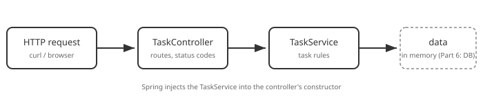

# Part 4: Services & Dependency Injection

## Table of Contents

1. [Why a Service Layer](#1-why-a-service-layer)
2. [Dependency Injection](#2-dependency-injection)
3. [Writing `TaskService`](#3-writing-taskservice)
4. [Wiring the Controller](#4-wiring-the-controller)
5. [Trying It](#5-trying-it)
6. [Beginner Pitfalls](#6-beginner-pitfalls)

---

## 1. Why a Service Layer



- The **controller** deals with HTTP: routes, status codes, request and response shapes.
- The **service** deals with the task rules: find, create, update, delete.
- Splitting them means each can change — and later be tested — on its own.

For now the service keeps tasks in memory; [Part 6](06-database-integration.md)
swaps in a real database without touching the controller.

## 2. Dependency Injection

`TaskController` needs a `TaskService`, but it never writes `new TaskService()`.
Instead it *declares* the need in its constructor, and Spring — which created both
as beans ([Part 2](02-packages-and-beans.md)) — passes the service in. That's
**dependency injection**.

```java
private final TaskService taskService;

public TaskController(TaskService taskService) {   // Spring supplies this
    this.taskService = taskService;
}
```

This is **constructor injection**, the convention for the whole course: the
dependency is `final`, the class can't be created half-wired, and there's no
`@Autowired` anywhere. With a single constructor, Spring needs no annotation to
know it should call it.

## 3. Writing `TaskService`

First a plain `Task` class, then the service holding them in a list:

```java
// src/main/java/com/example/taskapi/tasks/Task.java
package com.example.taskapi.tasks;

public class Task {

    private final Long id;
    private String title;
    private String description;
    private boolean done;

    public Task(Long id, String title, String description, boolean done) {
        this.id = id;
        this.title = title;
        this.description = description;
        this.done = done;
    }

    public Long getId() { return id; }
    public String getTitle() { return title; }
    public String getDescription() { return description; }
    public boolean isDone() { return done; }

    public void setTitle(String title) { this.title = title; }
    public void setDescription(String description) { this.description = description; }
    public void setDone(boolean done) { this.done = done; }
}
```

```java
// src/main/java/com/example/taskapi/tasks/TaskService.java
package com.example.taskapi.tasks;

import java.util.ArrayList;
import java.util.List;
import java.util.Optional;
import java.util.concurrent.atomic.AtomicLong;
import org.springframework.stereotype.Service;

@Service
public class TaskService {

    private final List<Task> tasks = new ArrayList<>();
    private final AtomicLong nextId = new AtomicLong(1);

    public List<Task> findAll() {
        return tasks;
    }

    public Optional<Task> findOne(Long id) {
        return tasks.stream().filter(task -> task.getId().equals(id)).findFirst();
    }

    public Task create(String title, String description, boolean done) {
        Task task = new Task(nextId.getAndIncrement(), title, description, done);
        tasks.add(task);
        return task;
    }

    public boolean remove(Long id) {
        return tasks.removeIf(task -> task.getId().equals(id));
    }
}
```

`@Service` makes it a bean, so Spring can inject it.

## 4. Wiring the Controller

Replace the hard-coded controller from Part 3 so it delegates:

```java
@RestController
@RequestMapping("/tasks")
public class TaskController {

    private final TaskService taskService;

    public TaskController(TaskService taskService) {
        this.taskService = taskService;
    }

    @GetMapping
    public List<Task> findAll() {
        return taskService.findAll();
    }

    @GetMapping("/{id}")
    public Task findOne(@PathVariable Long id) {
        return taskService.findOne(id).orElse(null); // we'll do better in Part 7
    }

    @PostMapping
    @ResponseStatus(HttpStatus.CREATED)
    public Task create(@RequestBody Map<String, Object> body) {
        return taskService.create((String) body.get("title"), (String) body.get("description"), false);
    }

    @DeleteMapping("/{id}")
    @ResponseStatus(HttpStatus.NO_CONTENT)
    public void remove(@PathVariable Long id) {
        taskService.remove(id);
    }
}
```

The casting in `create` is deliberately ugly — it's the problem that
[Part 5](05-dto-and-validation.md) solves. And `orElse(null)` returns `200` with an empty body for a
missing task, which [Part 7](07-error-handling.md) fixes.

## 5. Trying It

```bash
curl -X POST http://localhost:8080/tasks -H "Content-Type: application/json" \
  -d '{"title":"Learn DI","description":"constructor injection"}'
curl http://localhost:8080/tasks
curl -X DELETE http://localhost:8080/tasks/1
```

The task you create shows up in the list, then disappears. Restart the app and the
list is empty again — in-memory data doesn't survive, which is exactly what Part 6 fixes.

## 6. Beginner Pitfalls

- **Missing `@Service`.** Startup fails with *Parameter 0 of constructor in
  TaskController required a bean of type TaskService that could not be found*. Add the
  annotation (and keep the class under the application package).
- **`new TaskService()` inside the controller.** It works, but you've bypassed Spring —
  you lose the shared instance and every benefit of injection. Always declare it in the
  constructor.
- **`@Autowired` on a field.** It also works, and hides the dependency and makes the
  class harder to create outside Spring. Prefer the constructor.

**Official docs:**
- [Dependency injection](https://docs.spring.io/spring-framework/reference/core/beans/dependencies/factory-collaborators.html)
- [Spring beans and DI in Boot](https://docs.spring.io/spring-boot/reference/using/spring-beans-and-dependency-injection.html)

---

Previous: [Part 3 — Controllers & Routing](03-controllers-and-routing.md) ·
Next: [Part 5 — DTOs & Validation](05-dto-and-validation.md)
