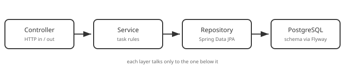

# Part 6: Database Integration (Spring Data JPA + PostgreSQL)

## Table of Contents

1. [The Layers So Far](#1-the-layers-so-far)
2. [PostgreSQL in Docker](#2-postgresql-in-docker)
3. [Dependencies and Connection Settings](#3-dependencies-and-connection-settings)
4. [The Schema, Owned by Flyway](#4-the-schema-owned-by-flyway)
5. [The Entity and the Repository](#5-the-entity-and-the-repository)
6. [Rewriting `TaskService`](#6-rewriting-taskservice)
7. [A Response DTO](#7-a-response-dto)
8. [Trying It](#8-trying-it)
9. [Beginner Pitfalls](#9-beginner-pitfalls)

---

## 1. The Layers So Far



- **Controller** — HTTP in, HTTP out.
- **Service** — the task rules.
- **Repository** — new this part: the only code that talks to the database.
- **PostgreSQL** — where the data finally survives a restart.

## 2. PostgreSQL in Docker

Rather than installing Postgres, run it in a container so everyone gets the same
database with one command. Create `docker-compose.yml` at the project root:

```yaml
name: springboot-task-api

services:
  db:
    image: postgres:17-alpine
    container_name: springboot-task-api-db
    environment:
      POSTGRES_USER: postgres
      POSTGRES_PASSWORD: postgres
      POSTGRES_DB: task_api
    ports:
      - '5424:5432'
    volumes:
      - task-api-db-data:/var/lib/postgresql/data

volumes:
  task-api-db-data:
```

```bash
docker compose up -d
```

The host port is `5424`, not Postgres's default `5432`, so it can't collide with a
Postgres you already have installed. The named volume keeps your data across
`docker compose down`; add `-v` to wipe it.

## 3. Dependencies and Connection Settings

Add to `build.gradle`:

```groovy
implementation 'org.springframework.boot:spring-boot-starter-data-jpa'
implementation 'org.springframework.boot:spring-boot-starter-flyway'
implementation 'org.flywaydb:flyway-database-postgresql'
runtimeOnly 'org.postgresql:postgresql'
```

**Spring Data JPA** (with Hibernate) maps Java objects to tables; the PostgreSQL
driver connects to the database; **Flyway** versions the schema (next section). Then
configure the connection:

```properties
# src/main/resources/application.properties
spring.datasource.url=${DATABASE_URL:jdbc:postgresql://localhost:5424/task_api}
spring.datasource.username=${DATABASE_USERNAME:postgres}
spring.datasource.password=${DATABASE_PASSWORD:postgres}

# Flyway owns the schema; Hibernate only checks that entities match it.
spring.jpa.hibernate.ddl-auto=validate
spring.jpa.open-in-view=false
```

Each `${NAME:default}` reads an environment variable and falls back to the value
after the colon. The defaults match `docker-compose.yml` and are throwaway local
values; real credentials would only ever arrive as environment variables.

## 4. The Schema, Owned by Flyway

A **migration** is a numbered SQL file that Flyway applies once, in order, and
records in a history table. Create `src/main/resources/db/migration/V1__create_task.sql`:

```sql
CREATE TABLE task (
    id          BIGSERIAL PRIMARY KEY,
    title       VARCHAR(120) NOT NULL UNIQUE,
    description TEXT,
    done        BOOLEAN      NOT NULL DEFAULT FALSE,
    created_at  TIMESTAMPTZ  NOT NULL DEFAULT now()
);
```

`ddl-auto=validate` means Hibernate never changes the schema — it only checks, at
startup, that your entity matches the table, and refuses to boot if not. Schema
changes always go in a *new* migration (`V2__...sql`); never edit one that has run.

## 5. The Entity and the Repository

Turn Part 4's plain `Task` into a JPA **entity** — a class mapped to the `task` table:

```java
// src/main/java/com/example/taskapi/tasks/Task.java
package com.example.taskapi.tasks;

import jakarta.persistence.Column;
import jakarta.persistence.Entity;
import jakarta.persistence.GeneratedValue;
import jakarta.persistence.GenerationType;
import jakarta.persistence.Id;
import java.time.Instant;

@Entity
public class Task {

    @Id
    @GeneratedValue(strategy = GenerationType.IDENTITY)
    private Long id;

    @Column(nullable = false, unique = true, length = 120)
    private String title;

    private String description;

    @Column(nullable = false)
    private boolean done;

    @Column(nullable = false, updatable = false)
    private Instant createdAt = Instant.now();

    protected Task() {
        // required by JPA
    }

    public Task(String title, String description, boolean done) {
        this.title = title;
        this.description = description;
        this.done = done;
    }

    public Long getId() { return id; }
    public String getTitle() { return title; }
    public String getDescription() { return description; }
    public boolean isDone() { return done; }
    public Instant getCreatedAt() { return createdAt; }

    public void setTitle(String title) { this.title = title; }
    public void setDescription(String description) { this.description = description; }
    public void setDone(boolean done) { this.done = done; }
}
```

The repository is an **interface** — you write no implementation:

```java
// src/main/java/com/example/taskapi/tasks/TaskRepository.java
package com.example.taskapi.tasks;

import org.springframework.data.jpa.repository.JpaRepository;

public interface TaskRepository extends JpaRepository<Task, Long> {

    boolean existsByTitle(String title);
}
```

Extending `JpaRepository<Task, Long>` gives you `findAll`, `findById`, `save`,
`delete` and more for free. `existsByTitle` is a **derived query**: Spring Data reads
the method name and writes the SQL.

## 6. Rewriting `TaskService`

The service now depends on the repository instead of a list. (It also takes on the
duplicate-title check — `409 Conflict` is wired up in [Part 7](07-error-handling.md);
for now the method signatures are what matter.)

```java
@Service
public class TaskService {

    private final TaskRepository taskRepository;

    public TaskService(TaskRepository taskRepository) {
        this.taskRepository = taskRepository;
    }

    @Transactional(readOnly = true)
    public List<TaskResponse> findAll() {
        return taskRepository.findAll().stream().map(TaskResponse::from).toList();
    }

    @Transactional(readOnly = true)
    public TaskResponse findOne(Long id) {
        return TaskResponse.from(getTask(id));
    }

    @Transactional
    public TaskResponse create(CreateTaskRequest request) {
        Task task = new Task(request.title(), request.description(), Boolean.TRUE.equals(request.done()));
        return TaskResponse.from(taskRepository.save(task));
    }

    @Transactional
    public TaskResponse update(Long id, UpdateTaskRequest request) {
        Task task = getTask(id);
        if (request.title() != null) task.setTitle(request.title());
        if (request.description() != null) task.setDescription(request.description());
        if (request.done() != null) task.setDone(request.done());
        return TaskResponse.from(task); // dirty checking saves the changes at commit
    }

    @Transactional
    public void remove(Long id) {
        taskRepository.delete(getTask(id));
    }

    private Task getTask(Long id) {
        return taskRepository.findById(id).orElseThrow(); // a real 404 arrives in Part 7
    }
}
```

`@Transactional` wraps the method in a database transaction. In `update` there is no
`save` call: the entity was loaded inside the transaction, so Hibernate notices the
changes and writes them when the method returns.

## 7. A Response DTO

Never return the entity itself over HTTP — it ties your public API to your table.
Return a response record instead:

```java
// src/main/java/com/example/taskapi/tasks/dto/TaskResponse.java
package com.example.taskapi.tasks.dto;

import com.example.taskapi.tasks.Task;
import java.time.Instant;

public record TaskResponse(Long id, String title, String description, boolean done, Instant createdAt) {

    public static TaskResponse from(Task task) {
        return new TaskResponse(task.getId(), task.getTitle(), task.getDescription(),
            task.isDone(), task.getCreatedAt());
    }
}
```

Update `TaskController` so every method returns `TaskResponse` (or `void`) and calls
the service directly — `findOne`, `update` and the rest no longer need `.orElse(null)`:

```java
@GetMapping("/{id}")
public TaskResponse findOne(@PathVariable Long id) {
    return taskService.findOne(id);
}
```

## 8. Trying It

```bash
./gradlew bootRun
```

The log shows Flyway applying `V1`. Then:

```bash
curl -X POST http://localhost:8080/tasks -H "Content-Type: application/json" \
  -d '{"title":"Persisted task"}'
curl http://localhost:8080/tasks
```

Stop the app, start it again, and `GET /tasks` still returns the task — it lives in
Postgres now. To look inside the database yourself:

```bash
docker exec -it springboot-task-api-db psql -U postgres -d task_api -c 'select * from task'
```

## 9. Beginner Pitfalls

- **Starting the app without the database.** It fails at startup with a *connection
  refused* error. Run `docker compose up -d` first.
- **Editing the schema by hand, or setting `ddl-auto=update`.** The database then
  drifts from your migrations. Change tables only through a new Flyway migration.
- **Returning the `@Entity` from a controller.** Today it works; tomorrow a new
  column leaks into the API, or a lazy relationship breaks serialization. Map to a
  response record.
- **Forgetting the no-argument constructor** on an entity — JPA needs one (it can be
  `protected`).

**Official docs:**
- [Spring Data JPA](https://docs.spring.io/spring-data/jpa/reference/)
- [Flyway with Spring Boot](https://docs.spring.io/spring-boot/how-to/data-initialization.html)

---

Previous: [Part 5 — DTOs & Validation](05-dto-and-validation.md) ·
Next: [Part 7 — Error Handling](07-error-handling.md)
