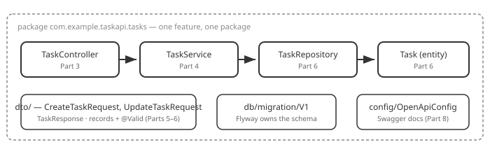

# Part 9: Architecture Review

## Table of Contents

1. [The Final Structure](#1-the-final-structure)
2. [Following One Request](#2-following-one-request)
3. [What You Built, Layer by Layer](#3-what-you-built-layer-by-layer)
4. [What's Next](#4-whats-next)

---

## 1. The Final Structure



```text
task-management-api/
├── build.gradle
├── docker-compose.yml
└── src/main/
    ├── java/com/example/taskapi/
    │   ├── TaskManagementApiApplication.java
    │   ├── config/OpenApiConfig.java
    │   └── tasks/
    │       ├── Task.java                 # JPA entity
    │       ├── TaskRepository.java       # talks to the database
    │       ├── TaskService.java          # the task rules
    │       ├── TaskController.java       # HTTP in, HTTP out
    │       └── dto/
    │           ├── CreateTaskRequest.java
    │           ├── UpdateTaskRequest.java
    │           └── TaskResponse.java
    └── resources/
        ├── application.properties
        └── db/migration/V1__create_task.sql
```

## 2. Following One Request

`POST /tasks` with `{"title": "Ship it"}`:

1. Spring's embedded **Tomcat** receives the request and routes it to `TaskController.create`.
2. The JSON body becomes a `CreateTaskRequest`, and **`@Valid`** checks it
   ([Part 5](05-dto-and-validation.md)) — invalid input is a `400` before any of our code runs.
3. The controller calls `TaskService.create`, which Spring injected
   ([Part 4](04-services-and-dependency-injection.md)).
4. The service checks the title is free — a duplicate throws a `409`
   ([Part 7](07-error-handling.md)) — and saves a `Task` through `TaskRepository`.
5. **Hibernate** writes the row to **PostgreSQL**, in a transaction
   ([Part 6](06-database-integration.md)).
6. The saved entity is mapped to a `TaskResponse` and returned with status `201`.

Every layer has one job and only talks to the next one down.

## 3. What You Built, Layer by Layer

| Layer | Part | Rule you followed |
| --- | --- | --- |
| Package-by-feature | [2](02-packages-and-beans.md) | A feature is a package; Spring finds beans by scanning |
| Controller | [3](03-controllers-and-routing.md) | Thin: map the route, call the service |
| Service | [4](04-services-and-dependency-injection.md) | Business rules; dependencies arrive by constructor |
| DTOs | [5](05-dto-and-validation.md) | Records at the boundary, `@Valid` on input |
| Repository + Flyway | [6](06-database-integration.md) | An interface for queries; schema only via migrations |
| Errors | [7](07-error-handling.md) | The right status code, thrown from the service |
| Docs | [8](08-api-documentation-swagger.md) | Generated from code, so it can't go stale |

## 4. What's Next

This crash course covers the ground you need for one working API, not the whole
framework. The reference app in [`examples/task-management-api/`](../examples/task-management-api/README.md)
is the finished version to compare against. Beyond it: authentication and
authorization with Spring Security, automated testing (unit and integration),
production concerns like rate limiting and configuration, containers and deployment,
and payments — everything a real application needs. The paid, live cohort builds a full
e-commerce API covering exactly that.

**Official docs:**
- [Spring Boot reference documentation](https://docs.spring.io/spring-boot/reference/index.html)
- [Spring Framework reference](https://docs.spring.io/spring-framework/reference/index.html)

---

Back to the [crash course README](../README.md).
